<!-- GitHub Profile README — Pooja Anbalagan. Commit README.md and profile.svg to the repo root. -->

 

[Projects](https://github.com/PoojaAnbalagan?tab=repositories) · [LinkedIn](https://www.linkedin.com/in/pooja-anbalagan/) · [Email](mailto:poojaap356@gmail.com)

[Sentiment Analytics](https://github.com/PoojaAnbalagan/SENTIMENTAL-ANALYSIS) · [AgroGuard-AI](https://github.com/SarasiRajarathna/AgroGuard-AI) · [CrowdVibe](https://github.com/aradhya534/CrowdVibe) ([live](https://crowd-vibe-seven.vercel.app/)) · [RelaunchHer](https://github.com/PoojaAnbalagan/relaunch_her) ([live](https://relaunchher.netlify.app/)) · [Barking Shelter](https://github.com/PoojaAnbalagan/Barking-Shelter)

